# Prospect & Enrich → AI Score & Personalize → Outreach → CRM → Measure Impact

```mermaid
flowchart LR
    subgraph sec_prospect["1 · PROSPECT & ENRICH"]
        direction TB
        trig(["Daily Prospect List Refresh"])
        pull_prospects["Pull New Prospects from the Sourcing Tool"]
        enrich["Enrich With Firmographic and Intent Data"]
    end
    subgraph sec_score["2 · AI SCORE & PERSONALIZE"]
        direction TB
        score_agent{{"Score Fit Against the ICP and Draft Personalized Outreach"}}
        score_model{{"GPT-4.1<br/><i>openai</i>"}}
        fit_branch{"ICP Fit Score Above Threshold?"}
    end
    subgraph sec_outreach["3 · OUTREACH"]
        direction TB
        send_email["Send the Personalized Outreach Email<br/><i>gmail</i>"]
        send_linkedin["Add to a Personalized LinkedIn Sequence"]
    end
    subgraph sec_sync["4 · SYNC TO CRM"]
        direction TB
        log_crm["Log the Prospect and Activity in the CRM<br/><i>hubspot</i>"]
        update_stage["Update Pipeline Stage Based on Engagement"]
    end
    subgraph sec_measure["5 · MEASURE IMPACT"]
        direction TB
        agg_perf["Aggregate Reply Rate, Meeting Rate, and Pipeline Generated"]
        perf_branch{"Reply Rate Below Benchmark?"}
        alert_underperform["Alert: Campaign Underperforming Benchmark<br/><i>slack</i>"]
        dashboard[("Write Metrics to the GTM Performance Dashboard<br/><i>googleSheets</i>")]
    end
    trig --> pull_prospects
    pull_prospects --> enrich
    enrich --> score_agent
    score_agent --> fit_branch
    fit_branch -->|true| send_email
    fit_branch -->|true| send_linkedin
    send_email --> log_crm
    send_linkedin --> log_crm
    log_crm --> update_stage
    update_stage --> agg_perf
    agg_perf --> perf_branch
    perf_branch -->|true| alert_underperform
    perf_branch -->|false| dashboard
    alert_underperform --> dashboard
    score_model -.- score_agent
    style sec_prospect fill:#dbeafe,stroke:#94a3b8,color:#0f172a
    style sec_score fill:#dcfce7,stroke:#94a3b8,color:#0f172a
    style sec_outreach fill:#ede9fe,stroke:#94a3b8,color:#0f172a
    style sec_sync fill:#f1f5f9,stroke:#94a3b8,color:#0f172a
    style sec_measure fill:#fef9c3,stroke:#94a3b8,color:#0f172a
```

- **1 · PROSPECT & ENRICH** — New prospects get pulled and enriched with firmographic and intent data before anything else touches them.
- **2 · AI SCORE & PERSONALIZE** — One AI step scores fit against the ICP and drafts personalized outreach, only qualified prospects move forward.
- **3 · OUTREACH** — Qualified prospects get personalized touches across email and LinkedIn.
- **4 · SYNC TO CRM** — Every prospect and touch logs to the CRM, so pipeline stage reflects real engagement, not guesswork.
- **5 · MEASURE IMPACT** — Reply rate, meeting rate, and pipeline generated roll up to the dashboard, and underperformance gets flagged before it wastes a quarter.
