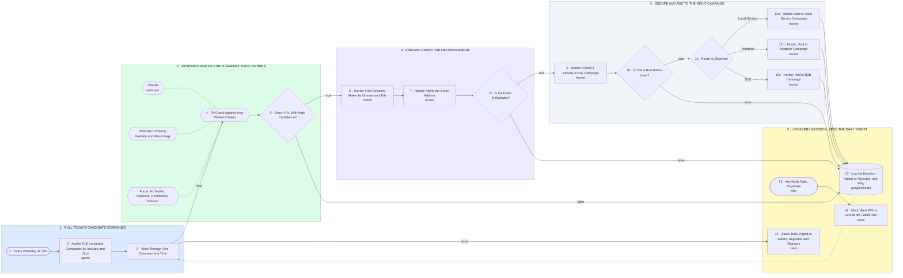

# Prospect Research, Fit-Check, Verify, Route to Hunter Campaign

- **1 · PULL TODAY'S CANDIDATE COMPANIES** — Runs every weekday morning. Pulls a small batch from the source list and works through it one company at a time.
- **2 · RESEARCH AND FIT-CHECK AGAINST YOUR CRITERIA** — Claude reads the company site and judges it against your written criteria. Anything it is not sure about gets rejected with the reason, not added.
- **3 · FIND AND VERIFY THE DECISION-MAKER** — Hunter finds the right person by title, then verifies the address. Unverified emails never reach a campaign.
- **4 · DEDUPE AND ADD TO THE RIGHT CAMPAIGN** — Skips anyone already in a campaign, then routes by segment: local service, medtech, or B2B.
- **5 · LOG EVERY DECISION, SEND THE DAILY DIGEST** — Every company lands in the log, added or rejected, with the reason. One Slack message a day shows both lists.
