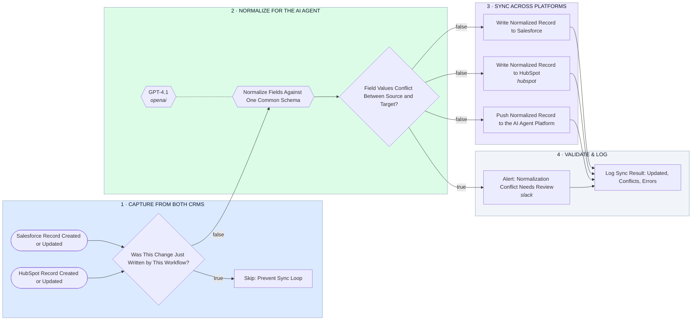

# Salesforce ↔ HubSpot ↔ AI Agent Platform — Normalize, Sync, Flag Conflicts

- **1 · CAPTURE FROM BOTH CRMS** — Either CRM can trigger the sync, and a loop guard drops anything this workflow just wrote itself.
- **2 · NORMALIZE FOR THE AI AGENT** — Fields get mapped to one common schema before anything moves, and a real conflict gets flagged instead of silently overwritten.
- **3 · SYNC ACROSS PLATFORMS** — Clean records write to Salesforce, HubSpot, and the AI agent platform together.
- **4 · VALIDATE & LOG** — Every run logs what updated, what conflicted, and what failed.
