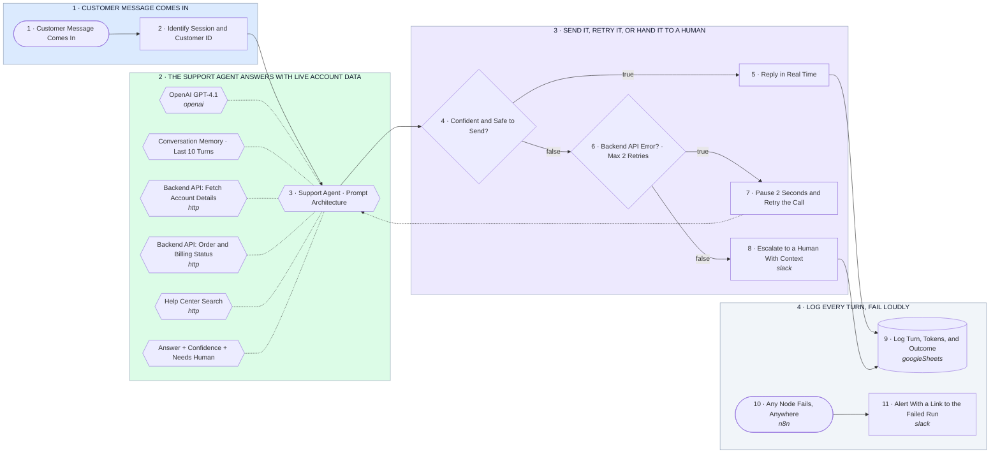

# Support Chatbot: Live Account Data, Confidence Gate, Human Handoff

- **1 · CUSTOMER MESSAGE COMES IN** — Every message is tied to a session and a customer id before the model sees it, so the agent never guesses whose account it is looking at.
- **2 · THE SUPPORT AGENT ANSWERS WITH LIVE ACCOUNT DATA** — One agent, a locked system prompt, and three tools that call your backend API. It reads real account, order and billing data instead of making it up.
- **3 · SEND IT, RETRY IT, OR HAND IT TO A HUMAN** — The reply only goes out when the model reports high confidence and no sensitive action. Backend errors retry once, everything else goes to a person with full context.
- **4 · LOG EVERY TURN, FAIL LOUDLY** — Each turn is logged with tokens and outcome so prompt changes can be measured. Any node failure alerts a human with a link to the run.
