# Webhook → External API (Paged, Authed, Rate-Limited) → JavaScript Transform → Google Sheets, With Logging

```mermaid
flowchart LR
    subgraph sec_in["1 · WEBHOOK IN"]
        direction TB
        hook(["Webhook Receives the Request"])
        validate["Validate and Shape the Payload in JavaScript"]
    end
    subgraph sec_api["2 · EXTERNAL API, DONE PROPERLY"]
        direction TB
        call_api["Call the External API With Auth and Rate-Limit Backoff"]
        more_pages{"More Pages to Fetch?"}
        normalize["Normalize Every Page Into One Clean Row Set in JavaScript"]
    end
    subgraph sec_sheet["3 · LOG TO SHEETS"]
        direction TB
        append[("Append the Structured Rows to Google Sheets<br/><i>googleSheets</i>")]
        respond["Respond 200 With the Row Count"]
    end
    subgraph sec_ops["4 · ERRORS & RUN LOG"]
        direction TB
        failed{"Did Anything Fail?"}
        alert["Alert With the Step and the Error<br/><i>slack</i>"]
        run_log[("Write the Run Log Row: Time, Rows, Pages, Status<br/><i>googleSheets</i>")]
    end
    hook --> validate
    validate --> call_api
    call_api --> more_pages
    more_pages -.->|true| call_api
    more_pages -->|false| normalize
    normalize --> append
    append --> respond
    respond --> failed
    failed -->|true| alert
    failed -->|false| run_log
    alert --> run_log
    style sec_in fill:#dbeafe,stroke:#94a3b8,color:#0f172a
    style sec_api fill:#dcfce7,stroke:#94a3b8,color:#0f172a
    style sec_sheet fill:#ede9fe,stroke:#94a3b8,color:#0f172a
    style sec_ops fill:#f1f5f9,stroke:#94a3b8,color:#0f172a
```

- **1 · WEBHOOK IN** — The request comes in and gets validated in JavaScript before anything else runs, so a bad payload fails loudly here instead of quietly later.
- **2 · EXTERNAL API, DONE PROPERLY** — Auth on the call, backoff on a rate limit, and it keeps paging until the API says it's done. That's the part that usually gets skipped and breaks at 10x volume.
- **3 · LOG TO SHEETS** — Every page gets normalized into the same clean rows in JavaScript, appended once, and the caller gets a real response with the row count.
- **4 · ERRORS & RUN LOG** — One run-log row per execution and an alert with the step and the error when something fails. Small on purpose, nothing here is more than the task needs.
