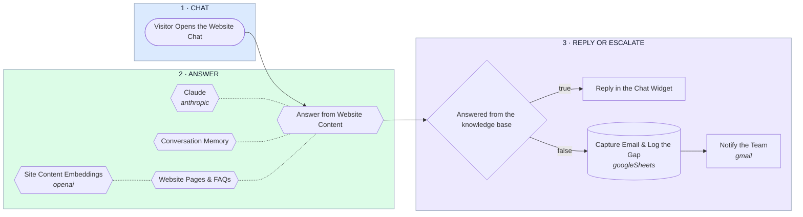

# Website Chatbot — Answer from Site Content, Escalate the Rest

- **1 · CHAT** — A single embed snippet on the existing site. No replatforming, no page rebuild.
- **2 · ANSWER** — Answers are retrieved from your own pages and FAQs, so the bot can only say things your site actually says.
- **3 · REPLY OR ESCALATE** — The important half: when the bot does not know, it says so, captures an email and tells you — instead of guessing at a customer.
