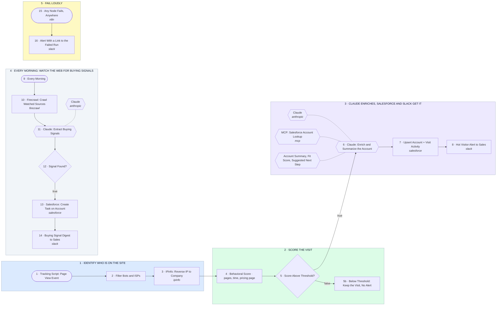

# Website Visitor ID + Buying Signals: IPinfo, Claude, Salesforce, Slack

- **1 · IDENTIFY WHO IS ON THE SITE** — The tracking script posts every page view here. Bots and home ISPs get dropped, real companies get named by their IP.
- **2 · SCORE THE VISIT** — Pages viewed, time on site and a pricing page visit add up to one number. Only hot visits go further.
- **3 · CLAUDE ENRICHES, SALESFORCE AND SLACK GET IT** — Claude checks Salesforce over MCP for an existing account, writes a summary, then the account and a Slack alert are created.
- **4 · EVERY MORNING: WATCH THE WEB FOR BUYING SIGNALS** — Firecrawl pulls the watched sources, Claude reads them for hiring, funding and expansion signals, and a Salesforce task lands on the matching account.
- **5 · FAIL LOUDLY** — Any node failing anywhere sends a Slack alert with a link to the run. Nothing dies silently on the Mac mini.
