# Your Bid Follow-Up System

```mermaid
flowchart LR
    subgraph sec_in["1 - A BID GOES OUT"]
        direction TB
        form(["1 - Bid Request Form Submitted<br/><i>ghl</i>"])
        tag_sent["2 - Tag the Contact bid-sent<br/><i>ghl</i>"]
        opp["3 - Open the Bid in the Pipeline<br/><i>ghl</i>"]
    end
    subgraph sec_touch["2 - FOUR TIMED TOUCHES"]
        direction TB
        w1["4 - Wait 1 Day"]
        sms1["5 - Text: Did You Get the Bid<br/><i>ghl</i>"]
        w2["6 - Wait 2 Days"]
        email1["7 - Email: Quick Recap of Your Bid<br/><i>ghl</i>"]
        w3["8 - Wait 4 Days"]
        sms2["9 - Text: Still Want to Move Forward<br/><i>ghl</i>"]
        w4["10 - Wait 7 Days"]
        email2["11 - Email: Last Check In<br/><i>ghl</i>"]
    end
    subgraph sec_cold["3 - NO ANSWER"]
        direction TB
        opp_cold["12 - Move the Bid to No Response<br/><i>ghl</i>"]
        tag_cold["13 - Tag the Contact bid-cold<br/><i>ghl</i>"]
    end
    subgraph sec_reply["4 - THE MOMENT THEY REPLY"]
        direction TB
        goal["14 - Goal: Customer Replied to the Bid<br/><i>ghl</i>"]
        untag["15 - Remove the bid-sent Tag<br/><i>ghl</i>"]
        opp_replied["16 - Move the Bid to Replied<br/><i>ghl</i>"]
        notify_sms["17 - Text the Owner<br/><i>ghl</i>"]
        notify_email["18 - Email the Owner<br/><i>ghl</i>"]
    end
    form --> tag_sent
    tag_sent --> opp
    opp --> w1
    w1 --> sms1
    sms1 --> w2
    w2 --> email1
    email1 --> w3
    w3 --> sms2
    sms2 --> w4
    w4 --> email2
    email2 --> opp_cold
    opp_cold --> tag_cold
    tag_cold --> goal
    goal --> untag
    untag --> opp_replied
    opp_replied --> notify_sms
    notify_sms --> notify_email
    style sec_in fill:#dbeafe,stroke:#94a3b8,color:#0f172a
    style sec_touch fill:#dcfce7,stroke:#94a3b8,color:#0f172a
    style sec_cold fill:#ede9fe,stroke:#94a3b8,color:#0f172a
    style sec_reply fill:#f1f5f9,stroke:#94a3b8,color:#0f172a
```

- **1 - A BID GOES OUT** - The website form fires the sequence and the bid is tracked as an opportunity.
- **2 - FOUR TIMED TOUCHES** - Text and email alternate on day 1, 3, 7 and 14. Business hours only.
- **3 - NO ANSWER** - After the last touch the bid is marked cold so nobody chases it by hand.
- **4 - THE MOMENT THEY REPLY** - The goal jumps any replier here, whatever day it is. The owner is told immediately.
