# Your GHL Lead Journey: No Duplicates, No Follow-Up After Booking

```mermaid
flowchart LR
    subgraph sec_entry["1 - EVERY LEAD LANDS AS ONE CONTACT"]
        direction TB
        in["1 - Form, Survey or Missed Call: One Contact, Tagged, Custom Fields Filled In"]
        mctb["2 - Missed Call Gets a Text Back From Your Business Number Right Away"]
    end
    subgraph sec_followup["2 - FOLLOW-UP THAT KNOWS WHEN TO STOP"]
        direction TB
        seq["3 - One Follow-Up Workflow Owns the Lead: Texts and Emails, Never Two at Once"]
        gate{"4 - Did They Reply, Book, Enter an Opportunity or Get Marked DND?"}
        stop["5 - Yes: Follow-Up Stops in Every Workflow, Not Just This One"]
    end
    subgraph sec_booked["3 - BOOKED, REMINDED, MOVED DOWN THE PIPELINE"]
        direction TB
        remind["6 - Booked: Confirmation Right Away, Then Reminders Before the Appointment"]
        after["7 - After the Appointment: A Follow-Up Text, and a Rebook Link if They Missed It"]
        pipe["8 - The Opportunity Moves Down Your Pipeline on Its Own at Each Step"]
    end
    subgraph sec_routing["4 - THE RIGHT PERSON HEARS ABOUT IT"]
        direction TB
        route["9 - Lead Goes to the Right Person, Who Gets a Text and a Task"]
    end
    subgraph sec_review["5 - CLEAN UP YOUR WORKFLOWS, THEN TEST THE WHOLE JOURNEY"]
        direction TB
        audit["10 - Review Your Workflows for Conflicts: Same Trigger Twice, Unnecessary Steps"]
        test["11 - Test Lead, Form to Booking: Each Message Once, Nothing After Booking, No Surprises"]
    end
    in --> mctb
    mctb --> seq
    seq --> gate
    gate -->|Yes| stop
    gate -.->|No| seq
    stop --> remind
    remind --> after
    after --> pipe
    pipe --> route
    route --> audit
    audit --> test
    style sec_entry fill:#dbeafe,stroke:#94a3b8,color:#0f172a
    style sec_followup fill:#dcfce7,stroke:#94a3b8,color:#0f172a
    style sec_booked fill:#ede9fe,stroke:#94a3b8,color:#0f172a
    style sec_routing fill:#f1f5f9,stroke:#94a3b8,color:#0f172a
    style sec_review fill:#fef9c3,stroke:#94a3b8,color:#0f172a
```

- **1 - EVERY LEAD LANDS AS ONE CONTACT** - Your parts 6 and 7: forms, surveys, tags, custom fields and missed-call text back. Whether they fill in a form or you miss their call, they land as one contact with a tag saying where they came from.
- **2 - FOLLOW-UP THAT KNOWS WHEN TO STOP** - Your parts 1, 2 and 8: SMS and email follow-up, the stop rules and the if/else check. Duplicate texts come from two workflows listening to the same trigger, so one workflow owns each lead, and one stop rule covers replies, bookings, opportunities and DND.
- **3 - BOOKED, REMINDED, MOVED DOWN THE PIPELINE** - Your parts 3 and 4: appointment reminders and follow-ups, pipeline and opportunity automation. Once they book, the follow-up is already off and only appointment messages go out.
- **4 - THE RIGHT PERSON HEARS ABOUT IT** - Your part 5: lead routing and internal notifications. Each lead has one owner, and that person is told the moment something needs them.
- **5 - CLEAN UP YOUR WORKFLOWS, THEN TEST THE WHOLE JOURNEY** - Your parts 9 and 10: reviewing your existing workflows for conflicts or unnecessary steps, then testing the complete lead journey and fixing what does not behave.
