# Your Rental Car CRM: Text and Email Automations Through the Process

```mermaid
flowchart LR
    subgraph sec_inquiry["1 - NEW RENTAL INQUIRY"]
        direction TB
        w1_trigger(["1 - Rental Inquiry Comes In: rental-inquiry Tag Added<br/><i>ghl</i>"])
        w1_clear["2 - Clear rental-inquiry So Their Next Inquiry Fires Again<br/><i>ghl</i>"]
        w1_opp["3 - Open the Card Under New Inquiry<br/><i>ghl</i>"]
        w1_sms["4 - Text Back: Which Dates and Which Car<br/><i>ghl</i>"]
        w1_email["5 - Email: What You Need to Rent With Us<br/><i>ghl</i>"]
        w1_owner["6 - Text You the New Inquiry<br/><i>ghl</i>"]
        w1_wait["7 - Wait 1 Day"]
        w1_nudge["8 - Text: Still Need a Car?<br/><i>ghl</i>"]
        w1_goal["9 - Goal: They Booked, So No Follow-Up Text<br/><i>ghl</i>"]
    end
    subgraph sec_booked["2 - BOOKING CONFIRMED"]
        direction TB
        w2_trigger(["10 - You Confirm the Booking: rental-booked Tag Added<br/><i>ghl</i>"])
        w2_clear["11 - Clear rental-booked for Their Next Rental<br/><i>ghl</i>"]
        w2_opp["12 - Move the Card to Booked - Docs Needed<br/><i>ghl</i>"]
        w2_sms["13 - Text: You Are Booked, Send License and Insurance<br/><i>ghl</i>"]
        w2_email["14 - Email: Confirmation, Deposit, Agreement and Rental Rules<br/><i>ghl</i>"]
        w2_task["15 - Task: Verify License, Insurance and Deposit Before Pickup<br/><i>ghl</i>"]
    end
    subgraph sec_returned["3 - CAR RETURNED"]
        direction TB
        w3_trigger(["16 - Car Comes Back: vehicle-returned Tag Added<br/><i>ghl</i>"])
        w3_clear["17 - Clear vehicle-returned for Their Next Rental<br/><i>ghl</i>"]
        w3_opp["18 - Move the Card to Returned - Inspection<br/><i>ghl</i>"]
        w3_sms["19 - Text: Thanks, Deposit Released After Inspection<br/><i>ghl</i>"]
        w3_task["20 - Task: Inspect, Log Mileage, Check If Service Is Due<br/><i>ghl</i>"]
        w3_wait["21 - Wait 2 Days While You Inspect"]
        w3_gate{"22 - Claim Open on This Rental?"}
        w3_hold["23 - Yes: Stop Here, No Review Ask During a Claim"]
        w3_done["24 - No: Move the Card to Rental Completed<br/><i>ghl</i>"]
        w3_review["25 - Send Your Review Request<br/><i>ghl</i>"]
    end
    subgraph sec_accident["4 - ACCIDENT REPORTED"]
        direction TB
        w4_trigger(["26 - Renter Reports an Accident: accident-reported Tag Added<br/><i>ghl</i>"])
        w4_clear["27 - Clear accident-reported for Any Future Report<br/><i>ghl</i>"]
        w4_claim["28 - Tag claim-open Until the Claim Is Settled<br/><i>ghl</i>"]
        w4_opp["29 - Move the Card to Accident or Claim<br/><i>ghl</i>"]
        w4_sms["30 - Text: Are You Safe, Then Photos and Police Report<br/><i>ghl</i>"]
        w4_email["31 - Email: Everything We Need to Open the Claim<br/><i>ghl</i>"]
        w4_owner["32 - Text You the Accident Right Away<br/><i>ghl</i>"]
        w4_task["33 - Task: Open the Accidents/Claims Record and Call Your Insurer<br/><i>ghl</i>"]
    end
    subgraph sec_ticket["5 - TICKET RECEIVED"]
        direction TB
        w5_trigger(["34 - A Ticket Comes In: ticket-received Tag Added<br/><i>ghl</i>"])
        w5_clear["35 - Clear ticket-received for the Next Ticket<br/><i>ghl</i>"]
        w5_clear_paid["36 - Clear an Old ticket-paid Tag<br/><i>ghl</i>"]
        w5_sms["37 - Text the Renter the Ticket and the Fee<br/><i>ghl</i>"]
        w5_email["38 - Email: Ticket Details and Your Payment Link<br/><i>ghl</i>"]
        w5_task["39 - Task: Log It in the Tickets Tab, Transfer or Pay<br/><i>ghl</i>"]
        w5_wait["40 - Wait 3 Days for Payment"]
        w5_gate{"41 - Still Unpaid?"}
        w5_nudge["42 - Yes: Text a Payment Reminder<br/><i>ghl</i>"]
        w5_paid["43 - No: Paid, Nothing More to Send"]
    end
    w1_trigger --> w1_clear
    w1_clear --> w1_opp
    w1_opp --> w1_sms
    w1_sms --> w1_email
    w1_email --> w1_owner
    w1_owner --> w1_wait
    w1_wait --> w1_nudge
    w1_nudge --> w1_goal
    w2_trigger --> w2_clear
    w2_clear --> w2_opp
    w2_opp --> w2_sms
    w2_sms --> w2_email
    w2_email --> w2_task
    w3_trigger --> w3_clear
    w3_clear --> w3_opp
    w3_opp --> w3_sms
    w3_sms --> w3_task
    w3_task --> w3_wait
    w3_wait --> w3_gate
    w3_gate -->|true| w3_hold
    w3_gate -->|false| w3_done
    w3_done --> w3_review
    w4_trigger --> w4_clear
    w4_clear --> w4_claim
    w4_claim --> w4_opp
    w4_opp --> w4_sms
    w4_sms --> w4_email
    w4_email --> w4_owner
    w4_owner --> w4_task
    w5_trigger --> w5_clear
    w5_clear --> w5_clear_paid
    w5_clear_paid --> w5_sms
    w5_sms --> w5_email
    w5_email --> w5_task
    w5_task --> w5_wait
    w5_wait --> w5_gate
    w5_gate -->|true| w5_nudge
    w5_gate -->|false| w5_paid
    style sec_inquiry fill:#dbeafe,stroke:#94a3b8,color:#0f172a
    style sec_booked fill:#dcfce7,stroke:#94a3b8,color:#0f172a
    style sec_returned fill:#ede9fe,stroke:#94a3b8,color:#0f172a
    style sec_accident fill:#f1f5f9,stroke:#94a3b8,color:#0f172a
    style sec_ticket fill:#fef9c3,stroke:#94a3b8,color:#0f172a
```

- **1 - NEW RENTAL INQUIRY** - The first of your text and email automations: someone asks about a car, gets a text back in seconds and an email with what they need to rent, and a follow-up the next day if they have not booked. The card opens under New Inquiry, the first of your headings in the opportunities tab, and texts go out once your GHL number's A2P registration is approved.
- **2 - BOOKING CONFIRMED** - When you confirm the booking, the renter gets the confirmation by text and email with the deposit, the agreement and your rules on tolls and tickets, and you get a task to verify license and insurance before pickup.
- **3 - CAR RETURNED** - When the car comes back, the renter gets a thank-you, you get an inspection task that feeds your Vehicles and Maintenance tabs, and two days later the review request goes out unless a claim is open.
- **4 - ACCIDENT REPORTED** - The renter gets a safety-first text and an email listing everything the claim needs, you get a text, and the card sits in Accident or Claim with a record in your Accidents/Claims tab until it is settled.
- **5 - TICKET RECEIVED** - Parking, toll and camera tickets show up after the car is back, so this one runs off the renter, not the open rental: ticket details, your admin fee and a payment link, a record in your Tickets tab, and one reminder if it is still unpaid.
